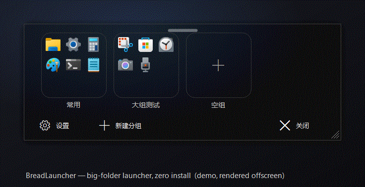

# BreadLauncher

**零安装的 Windows 启动面板** —— 双击弹出来，点图标就启动，关掉就退出。
*A zero-install Windows app launcher: one ~500 KB exe, no install, no background process.*

**它不搜索、不用打字。** 常用软件按用途放进 9 个大文件夹（"大格子"），点哪个开哪个 —— 你记的是位置，不是名字。
（开始菜单、PowerToys Run 那类是"输入名字找应用"；这个是"摊开一格一格直接点"。）

- **一格一个应用**：3×3 全摊开，超过 9 个滚轮翻页
- **右键管全部**：加应用 / 移除 / 改名 / 换组 / 排序
- **又透又能点**：亚克力半透明，点击和滚轮都留在面板上
- **约 500 KB 一个 exe**：不用管理员、不写注册表、没有托盘和后台 —— 删掉文件夹就是卸载

[**下载最新版**](../../releases/latest) · Windows 10 / 11（x64）· MIT

## 三步上手

1. 下载 `BreadLauncher.exe`，丢进一个固定目录（比如 `D:\Tools\BreadLauncher\`）
2. 双击打开 —— 第一次 Windows 可能提示 SmartScreen，点「更多信息 → 仍要运行」（没买代码签名，正常现象）
3. 右键任意格子开始整理；设置在最左下角的齿轮里

配置和图标缓存都只放在 exe 旁边，不用装 .NET。

## 常用操作

| 想干什么 | 怎么做 |
|---|---|
| 启动应用 | 点小图标 |
| 加应用 | 点卡片空白处，或右键 → 添加应用 |
| 管理应用 / 分组 | 右键任意格子 |
| 翻页 / 滚分组区 | 滚轮（停在文件夹上翻内页，停在空白处滚分组） |
| 换位置 | 拖小图标 = 组内排序；拖卡片本体 = 换分组位置 |
| 关面板 | 左下角「关闭」或 `Esc` |

更细的（全部操作、设置项、编译、数据位置、已知限制）→ **[docs/guide.md](docs/guide.md)**

许可：MIT
